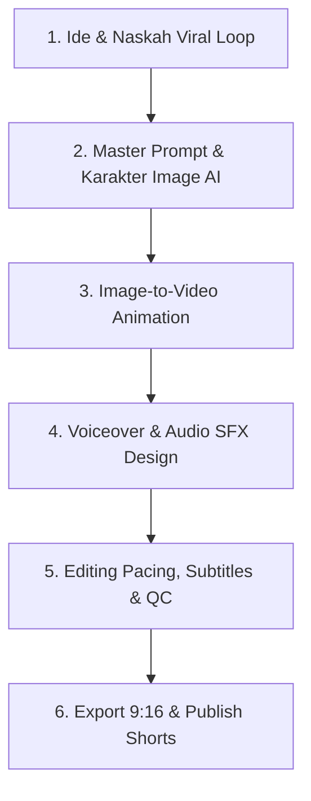

# 🎬 AI Animation Studio - YouTube Shorts High Views Pipeline

Selamat datang di workspace produksi video animasi AI. Workspace ini dirancang khusus untuk memproduksi konten **YouTube Shorts berpotensi viral** dengan efisiensi tinggi dan retensi maksimal.

---

## 📂 Struktur Direktori

- 📁 **`01_SOP_and_Guidelines/`**
  - [`team_roles.md`](file:///Users/user/Movies/00.%20Bahan/3.%20Antigravity/Video%20Ai/01_SOP_and_Guidelines/team_roles.md): Pembagian 5 peran tim produksi (Creative Director, Visual Lead, Motion Lead, Audio Specialist, Editor).
  - [`viral_shorts_formula.md`](file:///Users/user/Movies/00.%20Bahan/3.%20Antigravity/Video%20Ai/01_SOP_and_Guidelines/viral_shorts_formula.md): Formula retensi penonton (3-second hook, pacing 2 detik, seamless loop, audio psychology).
- 📁 **`02_Templates/`**
  - [`production_sheet_template.md`](file:///Users/user/Movies/00.%20Bahan/3.%20Antigravity/Video%20Ai/02_Templates/production_sheet_template.md): Template breakdown scene per scene (Image prompt, Video motion prompt, VO, SFX).
  - [`script_template.md`](file:///Users/user/Movies/00.%20Bahan/3.%20Antigravity/Video%20Ai/02_Templates/script_template.md): Template penulisan naskah high-retention.
- 📁 **`03_Projects/`**: Folder kerja untuk setiap episode/judul video baru.
- 📁 **`04_Assets/`**: Penyimpanan prompt library, audio, dan gambar referensi karakter.

---

## ⚡ Alur Kerja Pembuatan Konten (Workflow)

